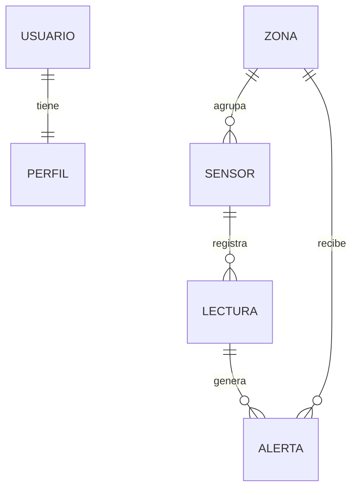

<div align="center">

# 💧 HidroMon API

**Sistema de Monitoreo de Humedad IoT**

API REST que gestiona usuarios, sensores, zonas de cultivo, lecturas de humedad y alertas
para el proyecto HidroMon.


</div>

---

## 📌 ¿Qué es HidroMon?

HidroMon es una plataforma que recolecta y gestiona datos de **humedad de suelo** y
**humedad ambiental** que envían sensores IoT instalados en los cultivos. Con esos datos,
agricultores y administradores pueden:

- 📡 **Recolectar** mediciones de los sensores de cada zona.
- 📊 **Monitorear** en tiempo real los niveles de humedad.
- 🎯 **Definir umbrales** mínimos y máximos para cada cultivo o zona.
- 🚨 **Recibir alertas** cuando una lectura se sale del rango.

Este repositorio contiene el **backend**. Está hecho en NestJS con TypeORM y Postgres, y cada
recurso sigue el mismo patrón de la clase: módulo, entidad, DTOs, controlador y servicio con repositorio.

## 🧩 Entidades



| Entidad | Campos | Qué representa |
|---|---|---|
| **Usuario** | `nombre`, `email`, `rol`, `perfil` | Agricultor o administrador que consulta el sistema |
| **Perfil** | `municipio`, `finca`, `nickname`, `avatar` | Datos del usuario (relación 1 a 1) |
| **Sensor** | `codigo`, `tipo`, `zonaId` | Dispositivo IoT de humedad de `Suelo` o `Ambiental` |
| **Zona** | `nombre`, `cultivo`, `humedadMin`, `humedadMax` | Área de cultivo con sus umbrales |
| **Lectura** | `sensorId`, `valor`, `fecha` | Una medición tomada por un sensor |
| **Alerta** | `lecturaId`, `zonaId`, `nivel`, `mensaje` | Aviso de que una lectura quedó por encima (`Alta`) o por debajo (`Baja`) del rango |

Todos los registros tienen `id` numérico, `createdAt` y `updatedAt`. Un sensor necesita una zona
que exista, una lectura necesita un sensor que exista y una alerta necesita una lectura y una zona que existan.

## 🛣️ Endpoints

Base: `http://localhost:3000`

Los cinco recursos comparten las mismas rutas:

| Método | Ruta | Descripción |
|---|---|---|
| `GET` | `/{recurso}` | Lista los registros (`{ data, count }`) |
| `GET` | `/{recurso}/:id` | Busca uno por su id |
| `GET` | `/{recurso}/search/:valor` | Búsqueda propia de cada recurso (tabla de abajo) |
| `POST` | `/{recurso}` | Crea un registro |
| `PUT` | `/{recurso}/:id` | Actualiza un registro |
| `DELETE` | `/{recurso}/:id` | Elimina un registro |

> En los cinco recursos `GET /{recurso}/1` responde **403 a propósito** (simulación de permisos vista en clase), y el id debe ser numérico: `GET /{recurso}/abc` responde 400.

Y cada uno trae una búsqueda propia:

| Recurso | Búsqueda | Ejemplo |
|---|---|---|
| `usuarios` | `GET /usuarios/search/:nombre` → devuelve el correo | `/usuarios/search/Diego Pinta` |
| `sensores` | `GET /sensores/search/:tipo` | `/sensores/search/Suelo` |
| `zonas` | `GET /zonas/search/:cultivo` | `/zonas/search/Papa` |
| `lecturas` | `GET /lecturas/search/:sensorId` | `/lecturas/search/1` |
| `alertas` | `GET /alertas/search/:nivel` | `/alertas/search/Alta` |

### Ejemplos

**Crear una zona**

```bash
curl -X POST http://localhost:3000/zonas   -H "Content-Type: application/json"   -d '{"nombre":"Lote Nuevo","cultivo":"Papa","humedadMin":60,"humedadMax":80}'
```

```json
{ "message": "Zona creada correctamente", "data": { "id": 3, "nombre": "Lote Nuevo", "cultivo": "Papa", "humedadMin": 60, "humedadMax": 80, "createdAt": "2026-11-12T06:37:44.766Z", "updatedAt": "2026-11-12T06:37:44.766Z" } }
```

**Crear un sensor en esa zona**

```bash
curl -X POST http://localhost:3000/sensores   -H "Content-Type: application/json"   -d '{"codigo":"HS-001","tipo":"Suelo","zonaId":3}'
```

**Actualizar una lectura**

```bash
curl -X PUT http://localhost:3000/lecturas/2   -H "Content-Type: application/json"   -d '{"valor":75}'
```

```json
{ "message": "Lectura actualizada correctamente", "data": { "id": 2, "valor": 75, "fecha": "2026-10-01T12:00:00.000Z", "sensor": { "id": 1 } } }
```

**Buscar algo que no existe**

```json
{ "message": "Sensor con ID 99 no existe", "error": "Not Found", "statusCode": 404 }
```

**Crear un sensor con una zona que no existe**

```json
{ "message": "Error al crear el sensor: revisa que la zona exista y que el código no esté repetido", "error": "Bad Request", "statusCode": 400 }
```

## 🚀 Cómo ejecutarlo

Necesitas **Node.js 24** o superior y **Docker** para la base de datos.

```bash
git clone https://github.com/diarpicu2022-commits/hidromon.git
cd hidromon
npm install
cp .env-example .env       # y llénalo con los datos de abajo
docker compose up -d       # levanta Postgres (5432) y pgAdmin (5050)
npm run start:dev
```

El `.env` no se sube al repo. Para el Postgres del `docker-compose.yml` queda así:

```env
POSTGRES_HOST=localhost
POSTGRES_PORT=5432
POSTGRES_DB=hidromon_db
POSTGRES_USER=hidromon_user
POSTGRES_PASSWORD=hidromon_password
```

Si falta una variable, la app no arranca: `app.module.ts` las lee con `configService.getOrThrow`.
pgAdmin queda en `http://localhost:5050`.

La API queda en `http://localhost:3000`. Para usar otro puerto: `PORT=4000 npm run start:dev`.

| Comando | Para qué |
|---|---|
| `npm run start:dev` | Desarrollo, se recarga sola al guardar |
| `npm run build` | Compila a `dist/` |
| `npm run start:prod` | Ejecuta lo compilado |
| `npm run test` | Pruebas unitarias |

## 🌱 Interfaz 3D (Three.js)

En `web/` hay un tablero con un invernadero 3D que consume la API y sirve para ver cómo funciona todo junto.

- **Inicio:** cada **zona** es una jardinera con su medidor de humedad (marca blanca = mínimo, amarilla = máximo) y los
  **sensores** cambian de color según su última lectura (verde dentro del rango, azul por debajo, rojo por encima, gris sin
  datos). El **cono de alerta** aparece solo si algún sensor de la zona está fuera de rango *ahora mismo* (las alertas
  guardadas quedan en el historial). Clic en una zona o sensor para ver su detalle, editarlo, eliminarlo o enviar una
  lectura aleatoria (si sale del rango se crea la alerta sola). A la derecha hay tarjetas de datos en tiempo real y el
  estado del sistema.
- **Historial:** últimas lecturas y alertas.
- **Gestionar:** crear, editar y eliminar zonas, sensores, lecturas y alertas. Eliminar pide confirmar con un segundo
  clic y, si el registro tiene dependientes (por ejemplo una zona con sensores), muestra el aviso 409 de la API.

```bash
# con la API corriendo en el puerto 3000
cd web
npm install
npm run dev                # http://localhost:5173
```

En desarrollo, Vite reenvía `/api` a `http://localhost:3000`, así que no hace falta CORS.
`npm run build` genera la versión estática en `web/dist/`.

## 📁 Estructura

```
src/
├── main.ts                # arranca la app con el ValidationPipe global
├── app.module.ts          # ConfigModule, TypeORM (Postgres) y los módulos
├── env.model.ts           # variables de entorno que usa la app
├── usuarios/
│   ├── entities/          # entidades TypeORM (Usuario, Perfil)
│   ├── dtos/              # DTOs de creación y edición con class-validator
│   ├── usuarios.controller.ts
│   ├── usuarios.service.ts
│   ├── usuarios.module.ts
│   └── *.spec.ts          # pruebas
├── sensores/              # misma estructura (entities/, dtos/, módulo)
├── zonas/
├── lecturas/
└── alertas/
```

## ⚠️ Limitaciones conocidas

- Las tablas se crean solas con `synchronize: true`. Sirve para desarrollo y clase; para producción habría que usar migraciones.
- Al empezar la base está vacía: crea primero una zona, luego un sensor, una lectura y una alerta, en ese orden (cada una necesita la anterior).
- `npm run test` no arranca con la configuración actual: NestJS 12 se distribuye como ES Module y el Jest de la plantilla no lo carga con Node anteriores a 24.9. Le pasa igual a la plantilla de la práctica.

## 🤝 Cómo contribuir

Nadie sube directo a `main` ni a `develop`. Cada cambio va en su propia rama y entra por Pull Request a `develop`.

```bash
git switch develop
git pull
git switch -c feature/<lo-que-vas-a-hacer>
# ...haces tus cambios...
git add .
git commit -m "feat(zonas): agregar busqueda por nombre"
git push -u origin feature/<lo-que-vas-a-hacer>
```

Luego abres el PR en GitHub hacia `develop`. La descripción se llena sola con la plantilla del equipo
(`.github/pull_request_template.md`): título, **Feature**, **Dev**, **Cambios** y **Pantallazos**.
Las cuatro secciones son obligatorias.

Los mensajes de commit siguen *Conventional Commits*:

| Tipo | Cuándo |
|---|---|
| `feat` | Nueva funcionalidad o endpoint |
| `fix` | Corrección de un error |
| `refactor` | Reorganizar código sin cambiar lo que hace |
| `style` | Formato, espacios, comas |
| `docs` | README o comentarios |
| `test` | Pruebas |
| `chore` | Configuración, dependencias, `.gitignore` |

Se puede indicar el módulo entre paréntesis: `fix(lecturas): ...`.

## 👥 Equipo

| Integrante | Programa |
|---|---|
| **Diego Armando Pinta Cuasquen** | Ingeniería Electrónica e Ingeniería de Software |
| **Leider Fabian Chipu Erazo** | Ingeniería de Software |
| **Juan José Rueda** | Ingeniería de Software |

<div align="center">

Proyecto académico · *Framework WEB* (Electiva 2) · 5.º semestre

</div>
